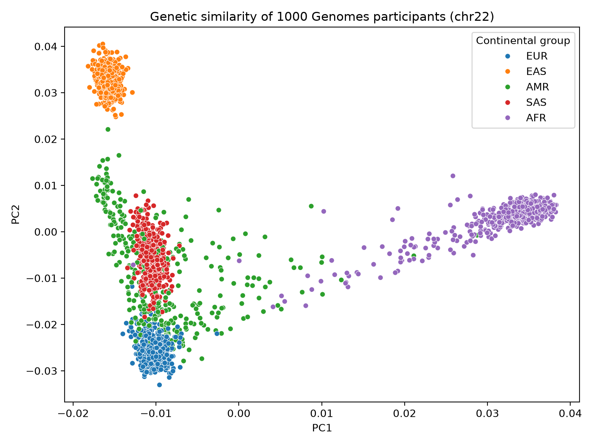
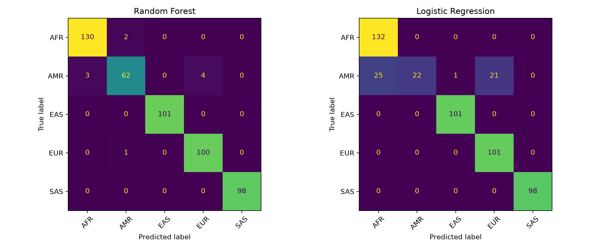

# Predicting continental ancestry from genotype data

## Why I did this
I am a veterinarian (DVM) with a Master's in Animal Genetics and Breeding. In animal genomics, I work on genomic evaluation of cattle. I built this project to practise Python and machine learning on human genotype data and to learn how methods I know from quantitative genetics, such as genotype quality control and working with large marker datasets, connect to a prediction workflow.

## Data
- **Source:** 1000 Genomes Project, Phase 3, chromosome 22 (N = 2,504 people; 1,055,454 variants before QC)
- **Labels:** Five continental groups: African (AFR), Admixed American (AMR), East Asian (EAS), European (EUR) and South Asian (SAS)

The data files are not included in this repository because of their size. Files used:
- `ALL.chr22.phase3_shapeit2_mvncall_integrated_v5b.20130502.genotypes.vcf.gz`
- `integrated_call_samples_v3.20130502.ALL.panel.txt`

Both come from the 1000 Genomes Phase 3 release. Put them in a `data/` folder.

## Methodology
1. Quality control (QC) of the genotype data with PLINK2:
   - kept only SNPs with two alleles
   - removed variants with minor allele frequency (MAF) < 0.05
   - removed variants with more than 5% missing genotypes (`--geno 0.05`)
2. Linkage disequilibrium (LD) pruning with a sliding window of 50 SNPs, advancing by 5 SNPs at each step, and an $r^2$ threshold of 0.2 to remove highly correlated SNPs.
3. Principal component analysis (PCA) was run, and the first 10 components were kept for each person.
4. The PCA results and each person's continental group were merged.
5. The first two principal components of each person were plotted on the X and Y axes.
6. The data were split into a training set (80%) and a test set (20%).
7. Two machine-learning models, Random Forest and Logistic Regression, were trained and evaluated on the test set to compare their performance in predicting ancestry.

## Key results
| Model | Accuracy (501 test people) | AMR recall |
|---|---|---|
| Random Forest | 98.00% | 89.86% |
| Logistic Regression | 90.62% | 31.88% |

## Visualising the PCA results
Each dot is one person. The position comes from the first two principal components (PC1 and PC2), which summarise the largest differences in genotypes between people. The colour shows the continental group from the 1000 Genomes panel. If individuals cluster according to their genetic similarities, their genotype data may contain informative patterns of population ancestry that machine-learning models can learn to identify and use for ancestry prediction.

### Observation in the PCA plot
People from the same continental group mostly cluster together, so the first two principal components already carry information about ancestry. East Asian (EAS) samples (orange) form a tight cluster at the top left, and European (EUR) samples (blue) form a tight cluster at the bottom. African (AFR) samples (purple) sit far to the right, with a tail of individuals extending towards the centre of the plot.

South Asian (SAS) samples (red) lie between the European and East Asian clusters and overlap partly with EUR and AMR. The Admixed American (AMR) group (green) is the most spread out, with individuals scattered between the European, African and East Asian clusters. This fits the idea that AMR individuals have ancestry from several source populations. However, the PCA plot alone cannot quantify admixture proportions or confirm the underlying ancestral contributions. Further validation using appropriate admixture analysis methods is required.

**Expected model performance:** Based on the observed clustering, the classification models are expected to distinguish East Asian, European and African individuals relatively well because these groups have comparatively distinct distributions in the PCA plot. Classification errors may be more frequent for South Asian and Admixed American individuals because of the partial overlap between these groups and other populations. However, actual predictive performance must be established using the test-set results rather than inferred from the PCA plot alone.

## Splitting of the data
The first 10 principal components (PCs) for each individual were used as input features, and the corresponding continental super-population group was used as the target label. The dataset was divided into training (80%) and test (20%) sets using stratified sampling, which preserves the relative representation of each group in both subsets. The training set comprised 2,003 individuals. The independent test set included 501 individuals and was reserved for evaluating model performance on unseen data. The test set consisted of 132 African (AFR), 101 East Asian (EAS), 101 European (EUR), 98 South Asian (SAS) and 69 Admixed American (AMR) individuals.

## Where do the models make mistakes?
The confusion matrices below show, for each true group (rows), how the model labelled those people (columns). Numbers on the diagonal are correct predictions.

### Confusion matrix analysis
The confusion matrices were examined to compare the classification performance of the Random Forest and Logistic Regression models across the five continental groups. The Random Forest model achieved an overall accuracy of 98%, indicating strong agreement between predicted and actual population labels. Logistic Regression achieved an accuracy of 91%, which is comparatively lower. The confusion matrices show the number of correctly classified individuals along the diagonal and the misclassified individuals in the off-diagonal cells. The performance of both models for the Admixed American (AMR) group needs particular attention: Logistic Regression achieved a recall of 0.32 for this group, so it correctly identified only about 32% of the actual AMR individuals in the test set. The next section describes where the remaining AMR individuals were assigned.

### Inference
The confusion matrices show differences in classification performance between Random Forest and Logistic Regression across the five groups.

The Random Forest model correctly classified 491 of the 501 individuals in the test set, an overall accuracy of approximately 98.00%. It performed particularly well for the AFR, EAS, EUR and SAS groups. Among the 69 AMR individuals, 62 were correctly classified, while three were misclassified as AFR and four as EUR. Random Forest therefore achieved an AMR recall of approximately 89.86%.

Logistic Regression correctly classified 454 of the 501 test individuals, an accuracy of approximately 90.62%. It correctly classified all individuals belonging to the AFR, EAS, EUR and SAS groups in this test set. However, its performance for AMR was considerably lower: only 22 of the 69 AMR individuals were correctly identified, a recall of approximately 31.88%. Of the remaining AMR individuals, 25 were misclassified as AFR, 21 as EUR and one as EAS.

These results indicate that AMR was the most challenging group for Logistic Regression, whereas Random Forest substantially reduced misclassification of this group. The difference suggests that Random Forest captured patterns in the principal component features that were more effective for distinguishing AMR individuals from the other groups. Nevertheless, the confusion matrices describe performance on this particular test set and do not by themselves establish how well either model will generalise to other populations or datasets.

*(Added)* Unlike my expectation from the PCA plot, SAS individuals were classified perfectly by both models, even though SAS overlaps with EUR and AMR in PC1/PC2. The models use all 10 PCs while the plot shows only two, so the other components probably carry information that separates SAS.

## Conclusion
This project investigated the application of machine-learning methods for predicting continental ancestry from human genotype data using the 1000 Genomes Project dataset. Genotype data were subjected to quality control and linkage disequilibrium pruning, followed by principal component analysis (PCA) to derive features representing major patterns of genetic variation. The first 10 principal components were used as predictors and the five continental super-population groups were used as target labels. Random Forest and Logistic Regression were trained using an 80:20 stratified train-test split and evaluated on an independent test subset.

Both models showed promising classification performance, but Random Forest outperformed Logistic Regression, with approximately 98.00% test accuracy compared with 90.62%. The most notable difference was for the Admixed American group, where Random Forest achieved approximately 89.86% recall compared with 31.88% for Logistic Regression. This highlights the importance of evaluating class-specific performance alongside overall accuracy, particularly when genetic populations show overlapping patterns of variation.

Overall, the findings show that PCA-derived features can support machine-learning-based prediction of continental population labels from genotype data, with Random Forest giving the stronger performance in this analysis. The results should be interpreted within the limitations listed below. Future work should evaluate additional chromosomes or genome-wide data, perform PCA within an appropriate training and evaluation framework, and use repeated or independent validation to assess the robustness and generalisability of the models.

## Limitations
- Only chromosome 22 was used
- A single train/test split was used
- PCA was computed on all people before splitting, so information may have leaked into the test set
- Related individuals may be present in both sets

## How to run it
1. Install the requirements: `pip install -r requirements.txt`
2. Download the two data files above into `data/`, and put `plink2` there too
3. Run the QC and PCA script: `bash scripts/01_qc_pca.sh`
4. Run the notebook `notebooks/ancestry_ml.ipynb`

## About me
Dipti, M.V.Sc. scholar in Animal Genetics and Breeding at ICAR-National Dairy Research Institute (NDRI), Karnal, India. Contact: pdiptimayee1@gmail.com